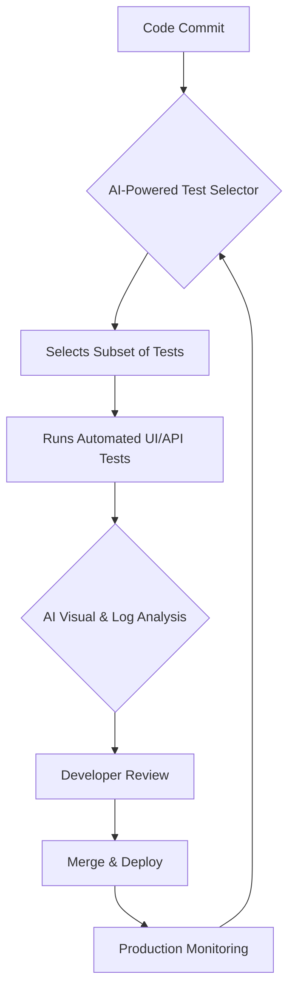

# Phase 1: AI-Driven Test Automation & Modern Tooling

## Overview

This phase covers the foundations of AI in Quality Engineering. You will build a quality gate engine, set up CI/CD pipelines, and learn how AI integrates into the testing lifecycle.

**Prerequisites:** Java 21+, Python 3.10+ (for AI modules), GitHub account

---

## Lesson 1.1: Introduction to AI in Quality Engineering

### Theory

Traditional QA relies on manual test cases and predefined automation scripts. AI-Driven Quality Engineering (QE) leverages machine learning to augment human testers, shifting quality from reactive to proactive.

**Key Applications:**
| Application | Description |
|-------------|-------------|
| Self-Healing Test Scripts | AI updates locator paths when UI changes |
| Test Case Generation | NLP analyzes user stories to generate test scenarios |
| Visual Regression Testing | Computer vision detects subtle UI discrepancies |
| Flaky Test Detection | ML identifies intermittent failures |
| Predictive Test Selection | AI selects relevant tests based on code changes |

**AI in the SDLC:**


**Reading Only:** No hands-on required for this lesson. Read and understand the concepts.

---

## Lesson 1.2: Hands-on Quality Engine (Java)

### Objective
Build a Java quality gate engine that evaluates whether a build is fit for deployment based on test results and coverage metrics.

### Step 1: Understand the Code

**`QualityEngine.java`** - Contains the core logic:

[View `QualityEngine.java`](./java/enterprise/qe/QualityEngine.java)

```java
package enterprise.qe;

public class QualityEngine {
    public static boolean evaluateQualityGate(int totalTests, int failedTests, double coveragePercentage, double minCoverageRequired) {
        if (failedTests > 0) {
            return false;
        }
        if (coveragePercentage < minCoverageRequired) {
            return false;
        }
        return true;
    }
}
```

**`QualityEngineTest.java`** - Verifies the gate logic:

[View `QualityEngineTest.java`](./java/enterprise/qe/QualityEngineTest.java)

```java
package enterprise.qe;

public class QualityEngineTest {
    public static void main(String[] args) {
        System.out.println("Running Enterprise Quality Engine Tests...");

        boolean result1 = QualityEngine.evaluateQualityGate(100, 0, 85.5, 80.0);
        assert result1 == true : "Test 1 Failed: Should pass quality gate";

        boolean result2 = QualityEngine.evaluateQualityGate(100, 2, 85.5, 80.0);
        assert result2 == false : "Test 2 Failed: Should fail due to test failures";

        boolean result3 = QualityEngine.evaluateQualityGate(100, 0, 75.0, 80.0);
        assert result3 == false : "Test 3 Failed: Should fail due to insufficient coverage";

        System.out.println("All Enterprise Quality Engine Tests Passed Successfully!");
    }
}
```

### Step 2: Compile and Run

From the workspace root:
```bash
javac -d bin ai/phase-1-ai-driven-test-automation/java/enterprise/qe/QualityEngine.java ai/phase-1-ai-driven-test-automation/java/enterprise/qe/QualityEngineTest.java
java -cp bin enterprise.qe.QualityEngineTest
```

**Expected Output:**
```
Running Enterprise Quality Engine Tests...
All Enterprise Quality Engine Tests Passed Successfully!
```

### Step 3: Verify
- [ ] Both Java files compile without errors
- [ ] All 3 test assertions pass
- [ ] Output shows "All Enterprise Quality Engine Tests Passed Successfully!"

---

## Lesson 1.3: GitHub Actions CI/CD Pipeline

### Objective
Configure a GitHub Actions workflow that automatically compiles, tests, and enforces quality gates on every push/PR.

### Step 1: Review the Workflow

**File:** [qe-ci.yml](./github/workflows/qe-ci.yml)

The workflow:
1. Triggers on push/PR to `main`/`master`
2. Sets up JDK 21 and Python 3.10
3. Compiles Java source code
4. Runs Java quality gate tests
5. Installs Python dependencies and runs smoke tests

### Step 2: Commit and Push

```bash
git add ai/
git commit -m "Add Phase 1 CI/CD workflow"
git push origin main
```

### Step 3: Verify in GitHub

- [ ] Go to your GitHub repository
- [ ] Click the "Actions" tab
- [ ] Verify the workflow runs successfully
- [ ] Confirm quality gates pass

---

## Lesson 1.4: AI Test Orchestration & Developer AI Tools (Python)

> **Note:** AI-specific code will be implemented in Python as requested.

### Theory

**LLM Agent Integrations & MCP Servers:**
AI Quality Assurance often involves building custom integrations where LLM agents interact with internal systems (often called "MCP Servers" - Multi-Contextual Processing or Management, Control, and Planning). This allows AI to perform tasks like:
- **Test Data Generation:** LLMs create realistic test data based on schemas or requirements.
- **Test Case Scaffolding:** LLMs generate initial test code from user stories or API specs.
- **Defect Analysis & Prioritization:** LLMs analyze logs/telemetry to predict defects or categorize issues.
- **Self-Healing Automation:** LLMs suggest fixes for broken selectors or logic.

The integration typically involves:
1.  **Orchestration Layer:** A Python script or service that acts as the agent.
2.  **API/SDK Calls:** The agent uses APIs (e.g., OpenAI, Gemini, local LLMs) to interact with LLM models.
3.  **Internal System Connectors:** The agent uses APIs or SDKs to interact with your company's systems (e.g., Jira for defect management, test management tools, internal data services, code repositories).

**Developer AI Tools in QE:**
Tools like GitHub Copilot, Cursor, and Devin AI are powerful assistants for QE engineers:
-   **Test Code Generation:** Quickly generate boilerplate for new tests, including test data, assertions, and framework setup.
-   **Debugging Assistance:** Get suggestions for fixing flaky tests or identifying root causes based on stack traces.
-   **Refactoring & Optimization:** Improve existing test code for readability, performance, and maintainability.
-   **Documentation Generation:** Auto-generate comments or documentation for complex test logic.

### Hands-on Exercise: LLM Test Data Generator (Python)

**Objective:** Create a Python script that simulates an LLM agent generating test data for a user profile, interacting with a mock internal system. This exercise introduces the concept of LLM agent integration for QE tasks.

**File:** [`./python/llm_test_data_generator.py`](./python/llm_test_data_generator.py)

```python
import json
import random

def generate_test_user_data(requirements: str) -> dict:
    # This function simulates an LLM generating data based on requirements.
    # In a real scenario, this would involve calling an LLM API (e.g., OpenAI, Gemini).

    print(f"Simulating LLM generating data for requirements: '{requirements}'")

    # Mock LLM output based on common user data requirements
    mock_data = {
        "valid_user": {
            "firstName": "John",
            "lastName": "Doe",
            "email": "john.doe@example.com",
            "age": 30,
            "isActive": True
        },
        "invalid_email_user": {
            "firstName": "Jane",
            "lastName": "Smith",
            "email": "invalid-email",
            "age": 25,
            "isActive": True
        },
        "minor_user": {
            "firstName": "Alice",
            "lastName": "Wonder",
            "email": "alice.wonder@example.com",
            "age": 16,
            "isActive": False
        }
    }

    # Simple logic to pick data based on keywords in requirements
    if "invalid email" in requirements.lower():
        return mock_data["invalid_email_user"]
    elif "minor" in requirements.lower():
        return mock_data["minor_user"]
    else:
        return mock_data["valid_user"]

def mock_save_user_to_db(user_data: dict) -> bool:
    # This simulates interacting with an "internal system" (e.g., a database API).
    print(f"Mock: Saving user to database: {user_data.get('email', 'N/A')}")
    if user_data.get('email') and '@' in user_data['email']:
        print("Mock: User saved successfully.")
        return True
    else:
        print("Mock: Failed to save user - invalid email.")
        return False

if __name__ == "__main__":
    print("--- LLM Test Data Generator ---")

    # Example 1: Generate a valid user
    req1 = "Generate data for a standard valid user"
    user1 = generate_test_user_data(req1)
    print(f"Generated user data: {json.dumps(user1, indent=2)}")
    mock_save_user_to_db(user1)
    print("-" * 30)

    # Example 2: Generate user with invalid email
    req2 = "Generate data for a user with an invalid email"
    user2 = generate_test_user_data(req2)
    print(f"Generated user data: {json.dumps(user2, indent=2)}")
    mock_save_user_to_db(user2)
    print("-" * 30)

    # Example 3: Generate a minor user
    req3 = "Generate data for a minor user (under 18)"
    user3 = generate_test_user_data(req3)
    print(f"Generated user data: {json.dumps(user3, indent=2)}")
    mock_save_user_to_db(user3)
    print("-" * 30)

    print("\n--- Using Developer AI Tools Conceptually ---")
    print("In a real scenario, developer AI tools like Copilot, Cursor, or Devin AI would assist directly in writing the above Python code, suggesting data structures, function implementations, and even generating docstrings or tests for this script.")
    print("For example, if you typed 'def generate_test_user_data(requirements: str) -> dict:' and paused, a tool like Copilot might suggest the entire mock_data dictionary and the if/elif logic based on common patterns.")
    print("Similarly, for 'def mock_save_user_to_db', the AI could suggest the database interaction logic.")
    print("-" * 30)

```

**Steps:**
1.  Ensure Python 3.10+ is installed and accessible.
2.  Create the file `./python/llm_test_data_generator.py` in the Phase 1 directory.
3.  Run the script from your terminal:
    ```bash
    python ai/phase-1-ai-driven-test-automation/python/llm_test_data_generator.py
    ```
4.  Observe how the "LLM agent" generates data based on mock requirements and simulates interaction with an "internal system."
5.  Reflect on how developer AI tools could have assisted in writing this code.

**Status:** Updated - Hands-on exercise created.

---


**Status:** Pending - Python environment setup required

---

## Phase 1 Checklist

```
[ ] Lesson 1.1 - Read AI in QE concepts
[ ] Lesson 1.2 - Build and run Quality Engine (Java)
[ ] Lesson 1.3 - Configure GitHub Actions CI/CD
[ ] Lesson 1.4 - AI Test Case Generation (Python) - Upcoming
```

**Next:** Proceed to [Phase 2 - Scalable Web & API Test Engineering](ai/phase-2-scalable-web-api-test-engineering/README.md)
