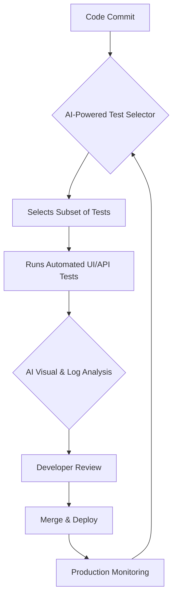

# Phase 1: AI-Driven Test Automation & Modern Tooling

## Overview

This phase covers the foundations of AI in Quality Engineering. You will build a quality gate engine, set up CI/CD pipelines, and learn how AI integrates into the testing lifecycle.

**Prerequisites:** Java 21+, Python 3.10+ (for AI modules), GitHub account

---

## Lesson 1.1: Introduction to AI in Quality Engineering

### Theory

Traditional QA relies on manual test cases and predefined automation scripts. AI-Driven Quality Engineering (QE) leverages machine learning to augment human testers, shifting quality from reactive to proactive.

**Key Applications:**
| Application | Description |
|-------------|-------------|
| Self-Healing Test Scripts | AI updates locator paths when UI changes |
| Test Case Generation | NLP analyzes user stories to generate test scenarios |
| Visual Regression Testing | Computer vision detects subtle UI discrepancies |
| Flaky Test Detection | ML identifies intermittent failures |
| Predictive Test Selection | AI selects relevant tests based on code changes |

**AI in the SDLC:**


**Reading Only:** No hands-on required for this lesson. Read and understand the concepts.

---

## Lesson 1.2: Hands-on Quality Engine (Java)

### Objective
Build a Java quality gate engine that evaluates whether a build is fit for deployment based on test results and coverage metrics.

### Step 1: Understand the Code

**`QualityEngine.java`** - Contains the core logic:

[View `QualityEngine.java`](./java/enterprise/qe/QualityEngine.java)

```java
package enterprise.qe;

public class QualityEngine {
    public static boolean evaluateQualityGate(int totalTests, int failedTests, double coveragePercentage, double minCoverageRequired) {
        if (failedTests > 0) {
            return false;
        }
        if (coveragePercentage < minCoverageRequired) {
            return false;
        }
        return true;
    }
}
```

**`QualityEngineTest.java`** - Verifies the gate logic:

[View `QualityEngineTest.java`](./java/enterprise/qe/QualityEngineTest.java)

```java
package enterprise.qe;

public class QualityEngineTest {
    public static void main(String[] args) {
        System.out.println("Running Enterprise Quality Engine Tests...");

        boolean result1 = QualityEngine.evaluateQualityGate(100, 0, 85.5, 80.0);
        assert result1 == true : "Test 1 Failed: Should pass quality gate";

        boolean result2 = QualityEngine.evaluateQualityGate(100, 2, 85.5, 80.0);
        assert result2 == false : "Test 2 Failed: Should fail due to test failures";

        boolean result3 = QualityEngine.evaluateQualityGate(100, 0, 75.0, 80.0);
        assert result3 == false : "Test 3 Failed: Should fail due to insufficient coverage";

        System.out.println("All Enterprise Quality Engine Tests Passed Successfully!");
    }
}
```

### Step 2: Compile and Run

From the workspace root:
```bash
javac -d bin ai/phase-1-ai-driven-test-automation/java/enterprise/qe/QualityEngine.java ai/phase-1-ai-driven-test-automation/java/enterprise/qe/QualityEngineTest.java
java -cp bin enterprise.qe.QualityEngineTest
```

**Expected Output:**
```
Running Enterprise Quality Engine Tests...
All Enterprise Quality Engine Tests Passed Successfully!
```

### Step 3: Verify
- [ ] Both Java files compile without errors
- [ ] All 3 test assertions pass
- [ ] Output shows "All Enterprise Quality Engine Tests Passed Successfully!"

---

## Lesson 1.3: GitHub Actions CI/CD Pipeline

### Objective
Configure a GitHub Actions workflow that automatically compiles, tests, and enforces quality gates on every push/PR.

### Step 1: Review the Workflow

**File:** [qe-ci.yml](./github/workflows/qe-ci.yml)

The workflow:
1. Triggers on push/PR to `main`/`master`
2. Sets up JDK 21 and Python 3.10
3. Compiles Java source code
4. Runs Java quality gate tests
5. Installs Python dependencies and runs smoke tests

### Step 2: Commit and Push

```bash
git add ai/
git commit -m "Add Phase 1 CI/CD workflow"
git push origin main
```

### Step 3: Verify in GitHub

- [ ] Go to your GitHub repository
- [ ] Click the "Actions" tab
- [ ] Verify the workflow runs successfully
- [ ] Confirm quality gates pass

---

## Lesson 1.4: AI Test Case Generation (Python) - Upcoming

> **Note:** AI-specific code will be implemented in Python as requested.

### Planned Content
- Install Python locally or via cloud (Azure/AWS/GCP free tier)
- Write Python script to generate test cases from requirements
- Use local LLM models or cloud AI APIs to keep costs down
- Integrate AI-generated tests into the CI pipeline

**Status:** Pending - Python environment setup required

---

## Phase 1 Checklist

```
[ ] Lesson 1.1 - Read AI in QE concepts
[ ] Lesson 1.2 - Build and run Quality Engine (Java)
[ ] Lesson 1.3 - Configure GitHub Actions CI/CD
[ ] Lesson 1.4 - AI Test Case Generation (Python) - Upcoming
```

**Next:** Proceed to [Phase 2 - Scalable Web & API Test Engineering](ai/phase-2-scalable-web-api-test-engineering/README.md)
